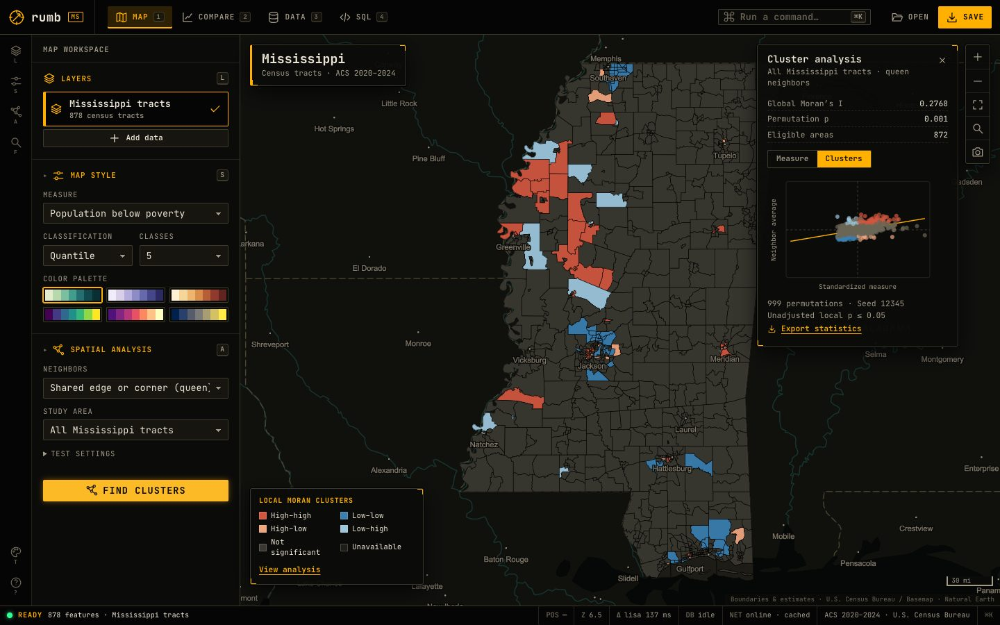

# rumb

A field GIS that runs entirely in your browser: maps, spatial SQL and cluster
statistics, with no server, no install and nothing uploaded. Open it from
[GitHub Pages](https://jossammil.github.io/bgis/), drop in your own files, and
keep working offline. The starter kit is all 878 Mississippi census tracts with
ACS poverty and CDC PLACES measures. rumb is named for the rhumb line, a
navigator's course of constant bearing. It was called Field Atlas (repository
`bgis`) before November 2026. *Frankensteined by MillJS.*



## What it does

- **Maps.** Choropleths of any numeric field, with quantile or equal-interval
  classes and six palettes (Viridis, Magma and Cividis among them).
  - Click a tract to inspect its estimate, ACS 90% margin of error and
    denominator. Its neighbors are dashed on the map.
  - Find a feature by name, county or ID with **F** or the palette.
  - Export a PNG with its title, legend and credits.
- **Cluster statistics.** Global Moran's I and Local Moran (LISA) with
  permutation inference, which matches R/spdep to nine decimal places.
  - Queen or rook contiguity; the whole state, one county or the current map
    extent as the study area.
  - 99 to 9,999 permutations with a fixed seed, and optional
    Benjamini–Hochberg adjustment.
  - Linked cluster map, Moran scatterplot and a plain-language reading of each
    area. **Export statistics** writes every result and setting to CSV.
- **Compare areas.** Rank polygons on two or three weighted indicators, with
  a linked map, scatterplot and table, and each area's percentiles,
  contributions and uncertainty.
- **Spatial SQL.** DuckDB with its spatial extension, in your browser.
  - Import CSV, Parquet, GeoParquet or GeoJSON by picking or dropping files.
  - Check a join to the tract GEOIDs before mapping it, and count points by
    tract.
  - Map any query that returns geometry or a GEOID, or export it to CSV.
- **Projects.** **Save** writes a `.rumb` file (a ZIP) with your imported
  files, reference data, settings, SQL and results; **Open** restores it.
  Field Atlas `.bgis` projects still open.
- **Offline.** Install it as an app, or choose **Download for offline** in the
  palette. The map, SQL and statistics then work with no network.
- **Themes for the conditions you work in.**
  - **Field Terminal** (amber and phosphor on black) is the default.
  - **Terminal · Night** turns everything, the map included, dim red, to keep
    night vision.
  - **Terminal · Daylight** is high contrast for sunlight.
  - **Tactical HUD**, **Rugged Field Kit** and **Starship**, Plank's console
    theme.
- **Keyboard first.** Ctrl/⌘ K opens a command palette that runs any command,
  switches layers and measures, changes theme and jumps to places. Single
  keys reach every tool, and a status bar shows the cursor position, zoom,
  timings, the SQL engine and the network.

## Use it

Open [rumb](https://jossammil.github.io/bgis/). The tract map appears first; the
SQL engine (DuckDB, about 59 MB) and the statistics code load only when you
first use them. Drop data files or a `.rumb` project anywhere on the page.
Press **?** for help, or Ctrl/⌘ K and start typing.

## Keyboard

| Key | Does |
| --- | --- |
| Ctrl/⌘ K or `:` | Command palette: commands, layers, measures, themes, places |
| 1 2 3 4 | Map, Compare, Data, SQL |
| L S A | Layers, map style, spatial analysis settings |
| R | Run Find clusters |
| F or `/` | Find a feature |
| 0, +, − | Fit the layer, zoom in, zoom out |
| I, O, Ctrl/⌘ S | Import data, open a project, save the project |
| E | Export the map as PNG |
| T | Next theme |
| ? | About rumb and the shortcuts |
| Esc | Close a panel or dialog; leave a text box |

Single keys work when the cursor is not in a text box.

## Data and methods

The 2020–2024 ACS five-year S1701 estimates use the population for whom poverty status is determined. Zero-denominator tracts have unavailable rates. The regional display uses simplified boundaries. The canonical GeoParquet and the rook and queen graphs use full-resolution 2024 TIGER/Line tract polygons. Reference geography and analysis weights stop at the Mississippi state boundary. The [Census source manifest](public/data/ms/sources.json) records the variables, original sources, preparation versions and checksums. The backdrop uses public-domain [Natural Earth](https://www.naturalearthdata.com/) geography. What each field means, and which files make up the region, is in its [catalog](public/data/ms/catalog.json).

Clustering uses first-order, row-standardized adjacency. Each run excludes missing measurements, zero denominators and areas with no eligible neighbors. The scatterplot locates each eligible area by its standardized measure and the mean of its neighbors' standardized measures. Observed local Moran statistics use GeoDaLib and sample variance. Global inference shuffles labels. Local inference holds the focal value fixed and samples neighbor values without replacement. The two-sided permutation tests count ties around the appropriate null expectation and use the plus-one correction. The default is 999 permutations with seed 12345, alpha 0.05. Optional Benjamini–Hochberg adjustment applies across tested local areas. The ACS margin of error describes survey sampling uncertainty. The permutation test conditions on the published estimates.

The comparison uses complete cases across all enabled indicators. Each percentile equals the number of lower values divided by the eligible count minus one. Constant fields receive 0.5. A lower-values direction uses one minus the percentile. Positive weights sum to 100. Scores are rounded to one decimal before competition ranking. Raw values at their median fall in the high half of their axis. Eight Mississippi tracts lack a complete default pair and remain visible as unranked. Tract PLACES estimates represent adults and carry 95% confidence intervals. These descriptive rankings use point estimates. [CDC PLACES 2025 tract data](https://data.cdc.gov/d/yjkw-uj5s) · [CDC methodology](https://www.cdc.gov/places/methodology/index.html)

To rebuild the data or check a result against R, see the [reproducibility guide](REPRODUCIBILITY.md).

## How it stays fast

- The first map needs about 1.1 MB of JavaScript (MapLibre is most of it) and
  1 MB of display geometry. DuckDB, GeoDaLib, jsts and zip.js are separate
  files loaded on first use; `dist/bundle-report.txt` lists what each file
  holds.
- Statistics run in a worker that stays alive between runs, so the page keeps
  drawing while 9,999 permutations run.
- DuckDB reads local files through browser file handles, so it reads only the
  parts of a large file a query needs.

A production build in headless Chrome on an Apple M2 Max (64 GB RAM) gave these
results with synthetic point GeoParquet. Times are from one run. "Read" counts
bytes requested from the point file, not from the reference tract file.

| Input | Rows | Register | Sum by category, all rows | Spatial join, first 50,000 points |
| --- | ---: | ---: | ---: | ---: |
| 49.99 MB | 924,548 | 0.03 s | 0.18 s, 1.26 MB read | 0.85 s, 1.17 MB read |
| 499.96 MB | 9,245,477 | 0.15 s | 1.63 s, 12.57 MB read | 0.90 s, 1.17 MB read |

The spatial query returned one result per tract and counted 39,670 points inside tracts in both files. During both queries the page kept receiving animation frames; the longest gap was 17 ms. These figures come from the Field Atlas baseline. To repeat them, run `Rscript scripts/benchmark-db.R <temporary-directory>`, then `npm run build`, `npm run serve` and `node scripts/benchmark-browser.mjs <temporary-directory>`.

## Limits

- One region ships today: Mississippi tracts. The catalog and the
  `data/<region>/` layout are ready for more states; adding them is data work.
- Map layers from SQL hold at most 10,000 features and 32 MiB of geometry; the
  SQL preview shows 100 rows. Filter or aggregate large inputs first.
- Weights are first-order queen or rook contiguity. Distance-band and
  nearest-neighbor weights, Getis-Ord Gi*, rate smoothing and regression are
  planned.
- Imports are CSV, Parquet, GeoParquet and GeoJSON. Shapefile, GeoPackage and
  KML are not read yet.
- Everything stays on your device. That also means a project file is the only
  way to move work to another browser.
- The service worker needs one online visit before offline use, and the
  browser may clear its cache when storage runs low unless it grants
  persistent storage.

## Development

Use Node.js 24 or later.

```sh
npm ci              # exact dependency versions
npm run dev         # build, rebuild on change, serve at http://127.0.0.1:4180/bgis/
npm test            # unit tests, including statistics checked against R
npm run build       # production build in dist/ (fetches and checks DuckDB's extensions)
npm run serve       # serve dist/ the way GitHub Pages does
npm run e2e         # browser checks; BROWSER=webkit for Safari's engine
```

The [developer guide](DEVELOPER-GUIDE.md) explains how the code fits together
and how to change it. The [reproducibility guide](REPRODUCIBILITY.md) rebuilds
the data and checks results against R. Pushes to `main` publish to GitHub Pages.

## Credits and licences

| Component | Licence | Used for |
| --- | --- | --- |
| [MapLibre GL JS](https://maplibre.org/) | BSD-3-Clause | The map |
| [DuckDB-Wasm](https://github.com/duckdb/duckdb-wasm) and its parquet, json and spatial extensions | MIT | Spatial SQL in the browser |
| [Apache Arrow](https://arrow.apache.org/) and FlatBuffers | Apache-2.0 | DuckDB result tables |
| [GeoDaLib](https://github.com/geodaai/geodalib) (`@geoda/lisa`) | MIT | Local Moran statistics |
| [JSTS](https://github.com/bjornharrtell/jsts) | EDL-1.0 or EPL-1.0 | Polygon contiguity for imported layers |
| [zip.js](https://gildas-lormeau.github.io/zip.js/) | BSD-3-Clause | `.rumb` project files |
| JetBrains Mono, Antonio, Chakra Petch and Saira Stencil One, via [Fontsource](https://fontsource.org/) | SIL OFL 1.1 | Theme fonts |
| [esbuild](https://esbuild.github.io/), [Playwright](https://playwright.dev/) | MIT, Apache-2.0 | Building and testing (not shipped) |
| U.S. Census Bureau TIGER/Line and ACS; CDC PLACES | Public data | Reference layer |
| [Natural Earth](https://www.naturalearthdata.com/) | Public domain | Backdrop |

The build writes each shipped component's version and licence, with the font
licence texts, to `dist/THIRD-PARTY.txt`.
